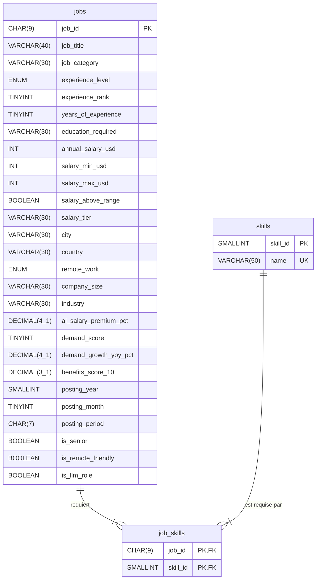

# Schéma de la base — MySQL 8.4

Modèle de la base qui alimente le dashboard (issues #14 et #15). Les tables correspondent exactement aux fichiers produits par `scripts/cleaning.py` (voir le [journal de nettoyage](journal_nettoyage.md)) ; le script SQL de création viendra en #16.

## 1. Modèle conceptuel (MCD)

Deux entités et une association :

- **Offre** : une offre d'emploi, identifiée par `job_id`.
- **Compétence** : une compétence demandée, identifiée par son nom.
- **Requiert** : une offre requiert une ou plusieurs compétences ; une compétence est requise par une ou plusieurs offres.

| Association | Côté Offre | Côté Compétence |
|---|---|---|
| Offre **requiert** Compétence | 1,N : chaque offre demande de 3 à 10 compétences | 1,N : chaque compétence apparaît dans 31 à 942 offres |

Relation **plusieurs-à-plusieurs** : en relationnel, elle devient une table de liaison.

## 2. Modèle logique (MLD)



> Mermaid n'accepte pas de virgule dans un type : `DECIMAL(4_1)` se lit `DECIMAL(4,1)`.

| Table | Lignes | Clé primaire | Clés étrangères |
|---|---|---|---|
| `jobs` | 1 500 | `job_id` | — |
| `skills` | 93 | `skill_id` (+ `name` unique) | — |
| `job_skills` | 9 428 | `(job_id, skill_id)` | `job_id` → `jobs.job_id`, `skill_id` → `skills.skill_id` |

### Choix des types

Les tailles sont choisies d'après les valeurs réelles (mesurées sur les CSV nettoyés), avec une marge :

| Colonnes | Valeurs observées | Type | Raison |
|---|---|---|---|
| `job_id` | toujours 9 caractères (`AIJOB0001`) | `CHAR(9)` | Longueur fixe |
| Libellés (`job_title`, `city`, `industry`…) | 24 caractères au plus | `VARCHAR(30)` à `VARCHAR(40)` | Marge sans gaspillage |
| `skills.name` | 23 caractères au plus, ASCII | `VARCHAR(50)` | Marge pour de nouvelles compétences |
| Salaires | 90 000 à 384 000, entiers | `INT` | Entiers après nettoyage |
| Pourcentages et notes | 1 chiffre après la virgule | `DECIMAL` | Valeurs exactes, sans erreur d'arrondi d'un flottant |
| `demand_score`, `years_of_experience`, `posting_month`, `experience_rank` | entre 1 et 98 | `TINYINT` | Petits entiers |
| `is_*`, `salary_above_range` | vrai / faux | `BOOLEAN` | Écrits 0/1 dans les CSV, format compris par `LOAD DATA` |
| `experience_level`, `remote_work` | 4 et 3 valeurs figées | `ENUM` | Toute valeur inconnue est refusée à l'import |

Contrôles prévus en #16 : `CHECK (salary_min_usd <= salary_max_usd)`, `demand_score` entre 0 et 100, `benefits_score_10` entre 0 et 10, `posting_month` entre 1 et 12.

### Stockage de `required_skills`

La colonne d'origine (`Python|SQL|Cloud`) n'est **pas** stockée telle quelle :

1. `cleaning.py` la découpe sur `|` et la dédoublonne (décisions C1 et C2).
2. Chaque compétence distincte devient une ligne de `skills`, avec un identifiant numérique.
3. Chaque couple offre–compétence devient une ligne de `job_skills`.
4. La colonne `required_skills` est retirée de `jobs`, pour éviter deux sources de vérité (C7).

La clé primaire composée `(job_id, skill_id)` empêche qu'une compétence soit comptée deux fois pour une même offre. Le « top des compétences » devient une simple jointure :

```sql
SELECT s.name, COUNT(*) AS offres
FROM job_skills js JOIN skills s ON s.skill_id = js.skill_id
GROUP BY s.skill_id, s.name
ORDER BY offres DESC;
```

### Pas de tables de référence pour les autres libellés

`country`, `industry`, `job_category`, `company_size`… restent de simples colonnes de `jobs` :

- ce sont des libellés **sans attribut propre** (un pays n'a ici ni code ni population) : une table séparée n'apporterait qu'une jointure de plus ;
- leurs valeurs sont déjà contrôlées par le nettoyage (garde-fous C4 et K4) et, pour les plus petites listes, par un `ENUM` ;
- les 1 500 offres sont chargées une fois et uniquement lues : le risque d'incohérence lié à la redondance est nul.

### Index

| Index | Pourquoi |
|---|---|
| `jobs (country)`, `(experience_level)`, `(industry)`, `(remote_work)`, `(job_category)`, `(job_title)` | Les 5 filtres obligatoires du dashboard |
| `job_skills (skill_id)` | Jointure inverse pour le top des compétences (la clé primaire couvre déjà `job_id`) |

Avec 1 500 lignes, le gain est négligeable en pratique : ces index documentent surtout les axes d'interrogation et serviraient si le volume augmentait.

## 3. Pourquoi MySQL (question obligatoire du sujet)

### Avantages dans ce projet

1. **Des données tabulaires au schéma fixe.** Les 1 500 offres ont toutes les mêmes 25 colonnes, sans valeur manquante ni structure imbriquée (hormis les compétences). Une table relationnelle les représente telles quelles, et les types stricts (`INT`, `DECIMAL`, `ENUM`, `CHECK`) **rejettent une donnée invalide dès l'import**.
2. **Un dashboard fait d'agrégations filtrées.** Tous les KPI et graphiques demandés (salaire par métier, par pays, par niveau, répartition du télétravail…) sont des `GROUP BY` combinés à des `WHERE` sur les 5 filtres : c'est exactement ce que SQL exprime le plus simplement, avec des index sur les colonnes filtrées.
3. **Des compétences en relation plusieurs-à-plusieurs.** La table de liaison et ses clés étrangères garantissent l'intégrité : pas de compétence orpheline, pas de doublon grâce à la clé primaire composée. Les analyses croisées (« compétences des rôles LLM », « salaire moyen par compétence ») se font par jointure.

### Limites dans ce projet

1. **Les compétences doivent être éclatées avant l'import.** MongoDB aurait stocké la liste telle quelle dans un tableau du document ; avec MySQL, il faut l'étape de normalisation de `cleaning.py` et trois fichiers à charger au lieu d'un.
2. **Pas de fonction `MEDIAN`.** Le salaire médian, KPI obligatoire, demande une requête avec fonctions de fenêtre (`ROW_NUMBER() OVER`) ou un calcul côté Python.
3. **Un schéma rigide.** Une nouvelle colonne dans une future version du dataset impose de modifier la table, là où MongoDB accepterait des documents différents.

### Comparaison rapide avec MongoDB

| Critère | MySQL (retenu) | MongoDB |
|---|---|---|
| Forme des données | Tables à colonnes fixes : correspond au CSV | Documents JSON : utile si les offres avaient des champs variables, ce qui n'est pas le cas |
| `required_skills` | Table de liaison, à préparer à l'import | Tableau dans le document, sans transformation |
| Requêtes du dashboard | `GROUP BY` / `WHERE` / jointures, simples à écrire et à vérifier | Pipelines d'agrégation, plus verbeux pour ces cas |
| Contrôle des données | Types, `ENUM`, `CHECK`, clés étrangères | Validation de schéma optionnelle |
| Évolution du schéma | Migration nécessaire | Souple |

MongoDB serait pertinent pour des documents hétérogènes, des écritures massives ou une montée en charge horizontale. Ici, les données sont **homogènes, chargées une seule fois et uniquement lues** : MySQL est le choix le plus simple et le plus sûr.

> Cette section est rédigée pour être reprise dans la **section 4 du rapport** (« Choix de la base »).
